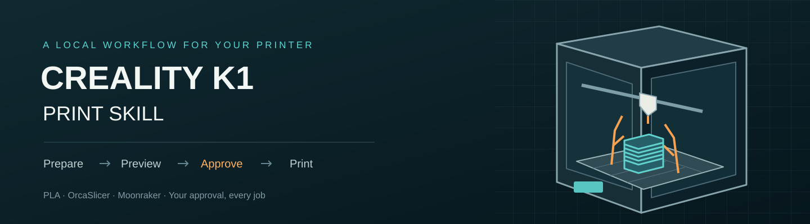
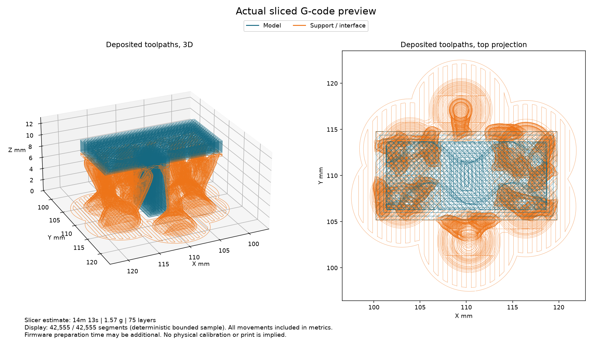

<div align="center">



# Creality K1 Print Skill

**Your model. A real toolpath preview. Your approval before printing.**

[](https://github.com/eep0x10/creality-k1-print-skill/actions/workflows/tests.yml)
[](pyproject.toml)
[](LICENSE)
[](README.md)

</div>

A local agent skill for the **original Creality K1**, PLA and a 0.4 mm nozzle. The agent inspects geometry, derives settings from your installed OrcaSlicer profiles, minimizes unnecessary support, slices locally and shows actual deposited G-code paths. Native Moonraker upload/start requires approval of the exact previewed file.

## Workflow

1. First choose **GPT decides** or **I choose**.
2. In manual mode, choose **strength versus filament savings** and **speed versus appearance/detail**. Delegated mode lets the agent assess the model.
3. Prepare geometry, size, orientation, walls, infill and supports locally.
4. Review the real toolpath PNG, dimensions, estimated time and grams.
5. Approve that result before upload/start. Changed artifacts require a new approval.

## Install

Requires Python 3.11+, installed [OrcaSlicer](https://github.com/OrcaSlicer/OrcaSlicer/releases), Moonraker 0.10.0 or later with API major 1, and an agent with local terminal access. Root access alone does not establish Moonraker connectivity. Do not install or change printer firmware during an active print.

```sh
git clone https://github.com/eep0x10/creality-k1-print-skill.git
cd creality-k1-print-skill
python scripts/install_skill.py --with-runtime
```

The installer uses `~/.agents/skills/creality-k1-print`, creates an isolated Python environment when requested, and never replaces an existing skill. Use `--target` for another skill directory. Installation never starts a print. See [setup](skills/creality-k1-print/references/setup.md) for configuration and direct CLI use.

Invoke it in a compatible agent:

```text
Use $creality-k1-print to configure my K1 and prepare this model.
First ask whether I want GPT to choose settings or make the choices myself.
```

A chat without a local executor cannot access your printer merely by loading these instructions.

## Included

- STL and geometry-only 3MF preparation, assembly transforms and uniform scaling.
- Derived official Orca K1 profiles and explicit strength/finish priorities.
- Actual toolpath previews, support colors, full bounds, estimates and artifact hashes.
- Bounded private-network discovery and read-only printer status.
- Approved native Moonraker transport with server checksum verification, identity/idle checks and no automatic POST retries.
- Offline synthetic tests. No downloaded third-party model, account session, printer identity or local configuration is distributed.

**Kiln is optional.** The core does not require Kiln or a cloud account. See [integrations](docs/INTEGRATIONS.md).



## Camera snapshots

With a working camera/snapshot service already configured, ask: **“Use $creality-k1-print to show me a camera photo and the print state.”** The skill retrieves a real local-network frame and shows it in chat with a retrieval timestamp and the separately observed printer state. Status requests skip new-print preference questions and never alter the print.

```sh
k1print snapshot --output snapshots/status.jpg
```

Use Moonraker webcam discovery or an explicit local snapshot URL. Root alone does not provide a camera or universal endpoint. Photos stay outside the repository; displaying them in chat is subject to that host's data policy. This feature does not install continuous monitoring. See the [camera guide](skills/creality-k1-print/references/camera.md).

## Continue on another PC or with another AI

Start with [AGENTS.md](AGENTS.md), the [AI guide](docs/AI_GUIDE.md), [project state](docs/PROJECT_STATE.md) and [continuity guide](docs/CONTINUITY.md). They explain constraints, verified behavior, open work, clean setup/tests and a handoff prompt. `CLAUDE.md` points to the same canonical instructions.

GitHub preserves public source and reusable knowledge. Real models, photos, custom profiles and receipts require a separate private owner archive; configure connection and credentials locally on the new machine. `prepare --profiles-dir` reuses a complete private profile set without generic overrides. Importing settings does not prove physical calibration. See [physical quality](skills/creality-k1-print/references/physical-quality.md) and [release verification](docs/RELEASING.md).

## Limits and documentation

The originating workflow confirmed a print start on an original K1; print completion and physical quality are separate evidence. The public package is tested with synthetic geometry and mocked requests. Profiles are starting points, not spool calibration. Display sampling is labeled; firmware macros are not simulated. Bed preparation, PLA loading and support removal remain physical steps. No public server, internet tunnel or permanent monitor is installed.

[Setup](skills/creality-k1-print/references/setup.md) · [Workflow](skills/creality-k1-print/references/workflow.md) · [Operating limits](skills/creality-k1-print/references/operating-limits.md) · [Architecture](docs/ARCHITECTURE.md) · [Privacy](docs/PRIVACY.md) · [Testing](docs/TESTING.md) · [Contributing](CONTRIBUTING.md)

Independent project, not affiliated with or endorsed by Creality. Original code is [MIT licensed](LICENSE); external tools retain their [own licenses and notices](THIRD_PARTY_NOTICES.md).
