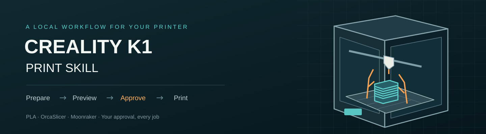
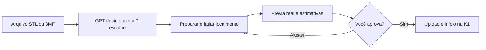
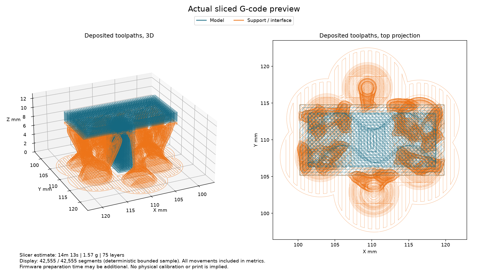

<div align="center">



# Creality K1 Print Skill

**Seu arquivo. Uma prévia real. Sua aprovação antes de imprimir.**

[](https://github.com/eep0x10/creality-k1-print-skill/actions/workflows/tests.yml)
[](pyproject.toml)
[](LICENSE)
[](README.en.md)

[Instalar](#comece-aqui) · [Como funciona](#do-modelo-à-k1) · [Continuar em outro PC](docs/CONTINUITY.md) · [Documentação](#documentação) · [Downloads](https://github.com/eep0x10/creality-k1-print-skill/releases)

</div>

Uma skill para agentes com acesso ao seu computador prepararem modelos em PLA na **Creality K1 original**: escolher orientação e configurações, reduzir suportes desnecessários, fatiar no OrcaSlicer e mostrar a prévia dos percursos reais. O envio pelo Moonraker só acontece depois do seu aceite daquele arquivo.

## Do modelo à K1

1. **Quem decide?** Primeiro, o agente pergunta se você quer delegar as configurações ou escolhê-las.
2. **Suas prioridades.** No modo manual, escolha robustez ou economia de filamento e velocidade ou beleza/detalhes. No modo delegado, o agente avalia o modelo.
3. **Preparação local.** Geometria, escala uniforme, orientação, suporte, paredes, preenchimento e acabamento.
4. **Prévia real.** PNG do G-code, dimensões, tempo e consumo estimados. A prévia identifica suportes e informa eventual amostragem visual.
5. **Seu aceite.** Somente depois da aprovação o arquivo é enviado e o início é solicitado. Alterar o G-code ou a prévia invalida o aceite anterior.



## Comece aqui

**Requisitos:** agente com terminal local, Python 3.11+, OrcaSlicer instalado e K1 original com Moonraker 0.10.0 ou superior, API major 1. Root sozinho não instala o Moonraker. O suporte inicial é PLA e bico de 0,4 mm; outras máquinas, materiais e bicos não foram validados.

```powershell
git clone https://github.com/eep0x10/creality-k1-print-skill.git
cd creality-k1-print-skill
python scripts/install_skill.py --with-runtime
```

O instalador copia a skill para `~/.agents/skills/creality-k1-print`, cria um ambiente Python isolado e instala suas dependências. **Não configura nem inicia a impressora e não substitui uma skill já instalada.** Para outro diretório, use `--target`. Consulte o [guia de instalação](skills/creality-k1-print/references/setup.md) para configurar conexão e OrcaSlicer.

Depois, em um agente compatível:

```text
Use $creality-k1-print para configurar minha K1 e preparar este modelo.
Quero que você primeiro pergunte quem vai escolher as configurações.
```

A skill também pode ser instalada pelo instalador de skills do seu agente apontando para a pasta [skills/creality-k1-print](skills/creality-k1-print). Um chat sem executor local não ganha acesso ao computador ou à impressora apenas por receber a skill.

## O que acompanha

| Recurso | Comportamento |
| :--- | :--- |
| Geometria | STL e geometria de 3MF, transformações de montagem e escala uniforme |
| Perfis | Derivados dos recursos oficiais do Orca ou importados de um conjunto local completo, sem reutilizar G-code externo |
| Prioridades | Robustez/economia e rapidez/detalhe, com modo equilibrado |
| Prévia | Percursos depositados reais, suportes destacados, estimativas e hashes |
| Conexão | Descoberta limitada à rede privada escolhida, consulta de estado e identidade |
| Câmera | Foto JPEG/PNG sob demanda, salva localmente e acompanhada do estado da impressora |
| Envio | Arquivo aprovado, verificação de checksum, upload sem início automático e uma solicitação de início |

O núcleo funciona **sem Kiln e sem conta de nuvem**. Kiln é uma integração opcional; [entenda a escolha do transporte nativo](docs/INTEGRATIONS.md).

## Ver a impressão pela câmera

Com uma câmera e um serviço de snapshot já configurados, peça: **“Use $creality-k1-print para me mostrar uma foto da câmera e o estado da impressão.”** A skill obtém uma foto real pela rede local e a mostra no chat com o horário da consulta. Esse pedido não refaz as perguntas de preparação nem altera a impressão.

```sh
k1print snapshot --output snapshots/status.jpg
```

A câmera pode ser descoberta pelo Moonraker ou definida na configuração local. A disponibilidade depende da sua instalação; root sozinho não fornece câmera nem endpoint universal. Não há monitoramento contínuo nesta função. Fotos permanecem fora do repositório; ao exibi-las no chat, vale a política de dados desse host. Veja o [guia da câmera](skills/creality-k1-print/references/camera.md).

## Continuar o desenvolvimento em outro PC

O projeto inclui **[AGENTS.md](AGENTS.md)** com as regras para agentes, um [guia de IA](docs/AI_GUIDE.md), [estado e pendências](docs/PROJECT_STATE.md) e um [roteiro de continuidade](docs/CONTINUITY.md) com instalação, testes e mensagem pronta para a próxima IA.

O clone público preserva código e conhecimento reutilizável. O proprietário transfere seus modelos, fotos, perfis e recibos separadamente, em um pacote privado. Segredos e conexão são configurados novamente no novo PC. Para fatiar com ajustes próprios, use `prepare --profiles-dir`; importar um perfil não o torna fisicamente calibrado.

## Exemplo sintético

Esta imagem usa uma peça original de teste, não um modelo de terceiros. Azul identifica o modelo; laranja identifica os suportes.



## Validação e limites

A origem deste fluxo inclui um início de impressão confirmado em uma K1 com Moonraker. Isso não comprova a conclusão ou a qualidade física de qualquer peça. O pacote público é testado com geometria sintética e requisições simuladas; não usa a impressora real como parte dos testes.

Os perfis são pontos de partida. A calibração física do seu rolo, a limpeza da mesa, o carregamento de PLA e a remoção dos suportes continuam necessários. Não há garantia de orientação ótima ou sucesso físico. Não há túnel pela internet, servidor público ou serviço permanente de monitoramento instalado. Veja [limites de operação](skills/creality-k1-print/references/operating-limits.md).

## Documentação

| Guia | Conteúdo |
| :--- | :--- |
| [Instalação](skills/creality-k1-print/references/setup.md) | Ambiente isolado, conexão, recursos Orca e comandos |
| [Fluxo de impressão](skills/creality-k1-print/references/workflow.md) | Preferências, preparação, prévia e aceite vinculado ao arquivo |
| [Câmera e status](skills/creality-k1-print/references/camera.md) | Foto sob demanda, descoberta, conexão manual e privacidade |
| [Arquitetura](docs/ARCHITECTURE.md) | Componentes, manifesto e transmissão |
| [Integrações](docs/INTEGRATIONS.md) | Moonraker, OrcaSlicer, fontes de modelos e Kiln opcional |
| [Privacidade](docs/PRIVACY.md) | Arquivos locais, segredos, rede e publicação |
| [Testes](docs/TESTING.md) | Comandos reproduzíveis, evidências e limites da validação |
| [Contribuir](CONTRIBUTING.md) | Desenvolvimento e revisão |
| [Instruções para IAs](AGENTS.md) | Regras canônicas e documentos obrigatórios para retomar |
| [Continuidade](docs/CONTINUITY.md) | Outro PC, instalação, dados privados e prompt para outra IA |
| [Estado do projeto](docs/PROJECT_STATE.md) | Funcionalidades, evidências, limitações e próximos passos |
| [Qualidade física](skills/creality-k1-print/references/physical-quality.md) | Calibração por rolo, interpretação de fotos e perfis próprios |
| [Publicação](docs/RELEASING.md) | Revisão, CI, pacote e conferência dos downloads |
| [Histórico de versões](CHANGELOG.md) | Mudanças públicas por versão |

Projeto independente, sem afiliação ou endosso da Creality. Código próprio sob [MIT](LICENSE); ferramentas externas mantêm suas próprias [licenças e avisos](THIRD_PARTY_NOTICES.md).
